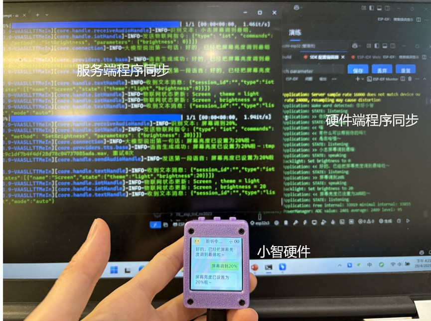
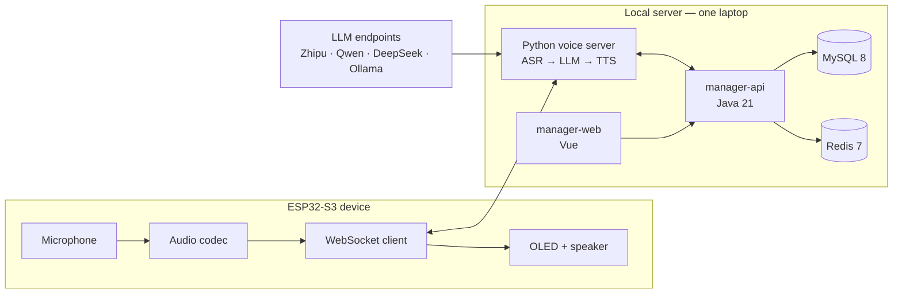
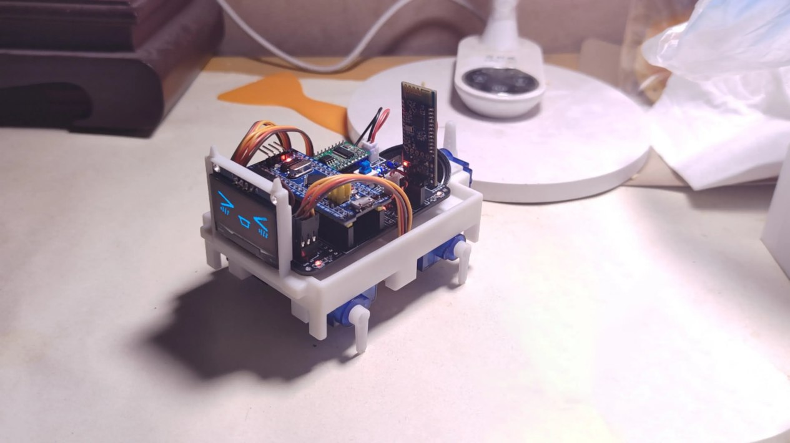
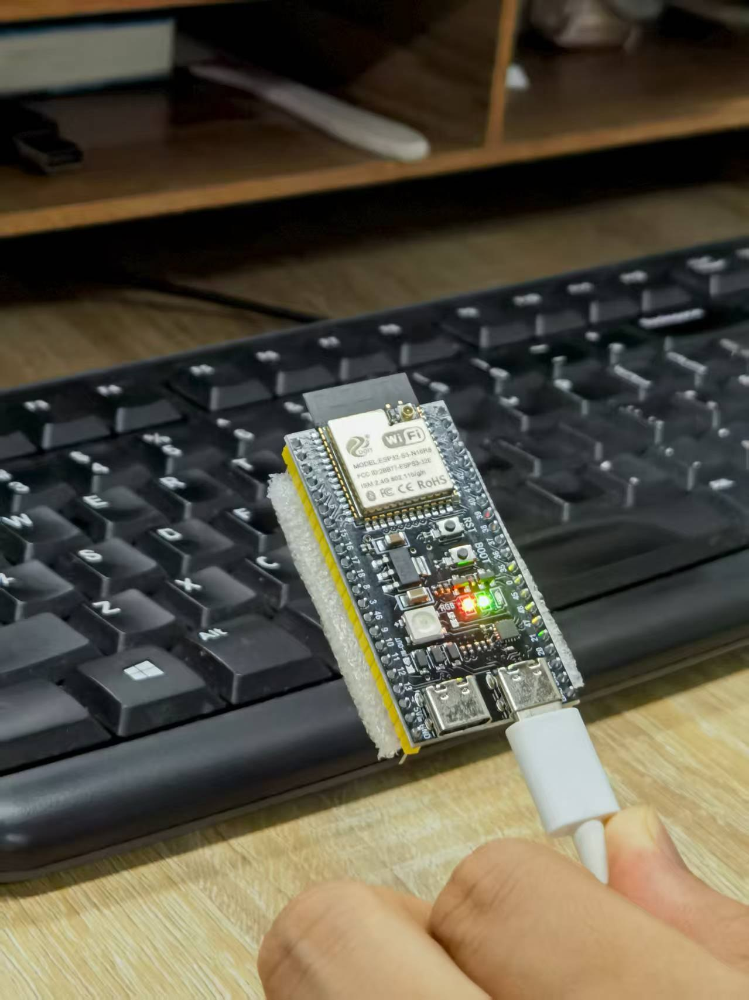

# Xiaozhi — a voice-first AI robot, built local-first

**A handheld device that listens, thinks and answers — with speech recognition, the language model, speech synthesis and the web console all running on one laptop.**

Built during a one-month R&D internship (June–July 2025). The brief was open on purpose: evaluate the ESP32 and STM32 platforms, explore the open-source Xiaozhi AI stack, and keep the whole system local instead of depending on someone else's cloud.



*The prototype executing a command. The log behind it is the local stack talking to the device.*

---

## What it does

- **Speak → answer.** The device streams audio to a local server, which runs speech-to-text, a language model, and text-to-speech, then streams the reply back.
- **Answer → action.** Commands are not just spoken; they are executed. Ask it to set the screen brightness to 20% and the OLED dims.
- **Bound devices, not open endpoints.** Each unit is registered in the console with a one-time code before it can talk to the server.
- **Config over the air.** The firmware pulls its OTA and WebSocket endpoints from config, so the same build can point at a laptop on the local network.
- **Swappable models.** The console can switch between hosted model providers or a local model, without reflashing the device.

## Architecture



The device never talks to a model directly. It talks to the voice server over one WebSocket; the server owns the pipeline, the console owns configuration, and MySQL/Redis hold devices, parameters and session state.

## Hardware

| Part | Choice |
|---|---|
| MCU | ESP32-S3 dev board (Wi-Fi + Bluetooth on chip) |
| Display | small OLED |
| Audio | microphone + speaker |
| Prototype | breadboard, then a handheld shell |
| Flashing | USB, with OTA/WebSocket endpoints baked into the firmware config |

| The breadboard stage | The ESP32-S3 board |
|:--:|:--:|
|  |  |

### ESP32-S3 vs STM32

| | ESP32-S3 | STM32 |
|---|---|---|
| Wi-Fi / Bluetooth | integrated | needs an external module |
| Footprint | smaller — the radio is on the board | larger once the module is added |
| Ecosystem | good, fast-moving | very mature, lots of reference material |
| Price | higher, and volatile | lower, but add the radio cost |
| Fit for this project | ✅ smaller device, fewer parts | good for control-heavy work, more wiring |

I wrote the trade-off down instead of picking a favourite: for a pocket-sized voice device, the integrated radio wins on size and assembly time.

## Software stack

| Layer | What ran |
|---|---|
| Device firmware | ESP32-S3 firmware, WebSocket client, OTA config |
| Voice server | Python 3.10 + SenseVoiceSmall for speech recognition, LLM call, TTS |
| API | Java 21 + Spring Boot (`manager-api`) |
| Console | Vue (`manager-web`), served locally |
| Data | MySQL 8 and Redis 7, both in Docker |
| Models | Zhipu GLM, Qwen, DeepSeek, Doubao, or a local model through Ollama |
| Config | `server.secret`, OTA + WebSocket endpoints, model parameters |

More detail: [`docs/stack.md`](docs/stack.md).

## Build log

| When | Phase | What happened |
|---|---|---|
| Jun 17–18 | Environment | Toolchain and source tree set up |
| Jun 19–21 | Parts | Ordered; a dead microphone and a dead OLED arrived, replacements were sent |
| Jun 20–27 | Flash + assemble | Voice module would not flash, a cold solder joint on the main board, flashing tool failures |
| Jul 1–7 | Backend, locally | Docker MySQL/Redis, Java API, Vue console; npm and file-permission problems |
| Jul 8–14 | Model + firmware | LLM endpoints configured, OTA/WebSocket values written, Anaconda environment issue |
| Jul 8–12 | Full local deployment | The whole stack on one laptop |
| Jul 10–15 | Documentation | Screenshots, issue list, write-up |

Full timeline and the issue table: [`docs/build-log.md`](docs/build-log.md).

## What broke (and what it taught me)

Eight issues, in roughly the order they appeared:

| Symptom | Layer | Resolution |
|---|---|---|
| Microphone produced nothing | Hardware | faulty part; replaced after the reshipment |
| OLED stayed dark | Hardware | faulty part; replaced |
| Voice module would not flash | Firmware / toolchain | re-flashed after fixing the toolchain |
| Main board had a cold solder joint | Hardware | re-soldered |
| Flashing program unusable | Toolchain | reinstalled and reconfigured |
| `npm` downloads failed | Front-end toolchain | switched registry / retried |
| Front-end file permission error | OS / front-end | fixed permissions |
| Anaconda environment not recognised | Python | recreated the environment |

The lesson that stuck: **most “software” problems in a toy are actually the parts.** A dead microphone looks like a protocol bug until you swap the microphone.

## Results

- A working handheld prototype: speak, get an answer, and see the device act on it.
- The full pipeline — ASR, LLM, TTS, console, database — running on one laptop.
- Devices registered and bound from the console with a one-time code.
- Eight hardware/software failures found and resolved in a month.
- Next: a printed shell, more sensors, and an MCP layer so the robot can reach smart-home devices instead of only answering questions.

## What I learned

1. **Bisect the stack.** The same symptom can live in firmware, the socket protocol, the model config or a container. Reading the log before touching the code saved hours.
2. **Change one variable at a time.** Especially with hardware: cable, part, solder joint, firmware, config — in that order.
3. **Local-first has a cost, and it is worth paying.** No cloud account, no API outage in the demo; but you own every dependency and every port.
4. **Write the trade-off down.** Choosing ESP32-S3 over STM32 was a decision with reasons, not a preference.

## Repo map

```
images/     photos from the build
docs/       build log, local stack notes, hardware notes, original report
README.md   this page
```

- [`docs/build-log.md`](docs/build-log.md) — dated milestones and the issue table
- [`docs/stack.md`](docs/stack.md) — what runs where, config flow, model switching
- [`docs/hardware.md`](docs/hardware.md) — MCU comparison, parts quality, debugging notes
- [`docs/xiaozhi-internship-report.docx`](docs/xiaozhi-internship-report.docx) — the original Chinese build report (the personal review section at the end is omitted)

## Running it

This repository is a build log, not a packaged distribution. The upstream open-source project is
[`xinnan-tech/xiaozhi-esp32-server`](https://github.com/xinnan-tech/xiaozhi-esp32-server) — follow its documentation for the server and firmware.

At a high level:

1. Start MySQL and Redis (Docker), then the Java API and the Vue console.
2. Create the first (super-admin) account in the console and configure a model provider.
3. Create a Python environment, install the voice-server dependencies, and download the speech-recognition model.
4. Fill in `server.secret` and the OTA/WebSocket endpoints, then start the voice server.
5. Flash the firmware with the OTA/WebSocket addresses; bind the device with the code shown on its screen.

No keys or private configuration are stored in this repo.

## Credits

- Built on the open-source [xiaozhi-esp32-server](https://github.com/xinnan-tech/xiaozhi-esp32-server) stack. The deployment, hardware assembly, debugging and documentation are my work.
- Photos are from my own build.
- Portfolio / case study: <https://www.whalemory.com/#xiaozhi>

## 中文简介

一个用声音对话的 AI 机器人：设备端是 ESP32-S3，服务端在本地笔记本上跑完整链路——Docker 里的 MySQL/Redis、Java 的管理后端、Vue 的智控台、Python 的语音服务（SenseVoice 识别 + 大模型 + 合成），模型可切智谱 / 千问 / DeepSeek / 本地 Ollama。2025 年 6—7 月用一个月从零件做到能对话，期间修掉 8 个软硬件问题。仓库里是英文搭建记录、排障表和硬件笔记；`docs/` 里附了原始中文报告的技术部分（文末的个人评语已去掉）。
