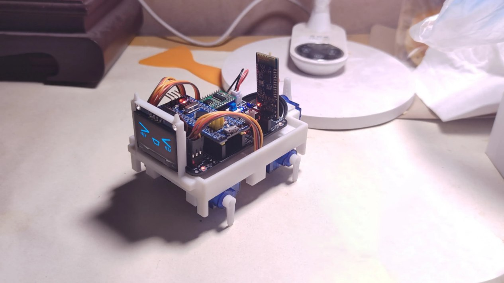
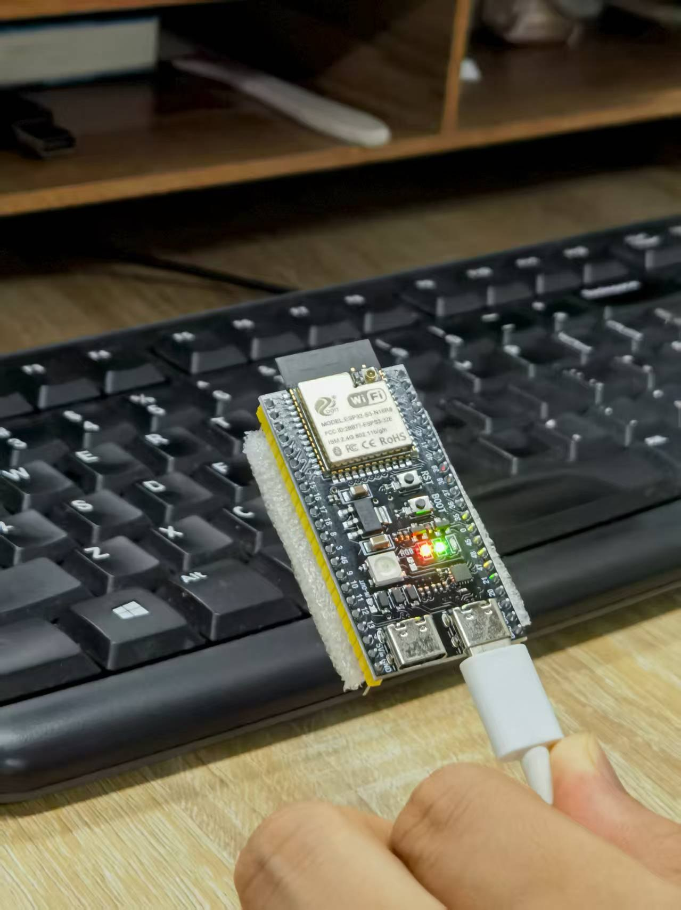

# Hardware notes

## The device

An ESP32-S3 dev board, a small OLED, a microphone, a speaker, and a printed shell around a
breadboard prototype. Power and data over USB; audio and commands over Wi-Fi.

| The breadboard stage | The board |
|:--:|:--:|
|  |  |

## ESP32-S3 vs STM32

| | ESP32-S3 | STM32 |
|---|---|---|
| Radio | Wi-Fi + Bluetooth integrated | needs an external Wi-Fi/Bluetooth module |
| Size | smaller: no radio module, fewer traces | larger once the module and antenna are added |
| Documentation | good and improving quickly | very mature; almost every problem has an answer |
| Toolchain | ESP-IDF / Arduino | STM32Cube / HAL, broad vendor support |
| Price | higher at launch, volatile | lower for the MCU, but add the radio |
| Best fit | compact connected devices, fast iteration | control-heavy work, long-life products |

For a pocket-sized voice device, the integrated radio is the deciding factor: fewer parts, fewer
failure points, and a smaller enclosure. The cost is a higher unit price.

## Parts quality

Three of the failures in this build were hardware, not software:

1. **Microphone dead on arrival.** The device was “listening” but never produced audio. Replacing
   the microphone fixed it.
2. **OLED dead on arrival.** The display stayed dark regardless of the firmware.
3. **Cold solder joint on the main board.** Intermittent behaviour that looked like a firmware bug
   until the joint was reflowed.

A reshipment was needed for the first two. The pattern is worth remembering: when a cheap module
fails, check the part before rewriting the code.

Two market notes from the build:

- **Prices move with competitions.** When a competition mandates a specific MCU family, those parts
  can spike several times over. Choosing a widely held part (ESP32 or STM32) keeps the bill stable.
- **Second-hand sellers are common.** The flood of individual developers into the space means some
  marketplace parts are resold or untested. Buy from a seller with a return path.

## Debug order that worked

When the device misbehaves, go down this list and stop at the first failure:

1. **Power** — is the board enumerating? Is the LED on?
2. **Connection** — are the wires in the right pins, and is the solder joint solid?
3. **Firmware** — does it flash cleanly, and does the serial log show the expected boot?
4. **Network** — can the device reach the WebSocket and OTA endpoints? Use the LAN IP, not
   `127.0.0.1`.
5. **Protocol** — is the server receiving frames? Check the voice server log.
6. **Pipeline** — does ASR produce text? Does the model answer? Does TTS return audio?

The most expensive mistakes were skipping step 2 and assuming step 3.

## Next

- A proper printed shell with room for the speaker and a battery.
- More sensors (the project direction explored motors, head/neck movement and a simple robot body).
- An MCP layer so the device can reach smart-home endpoints instead of only answering questions.
